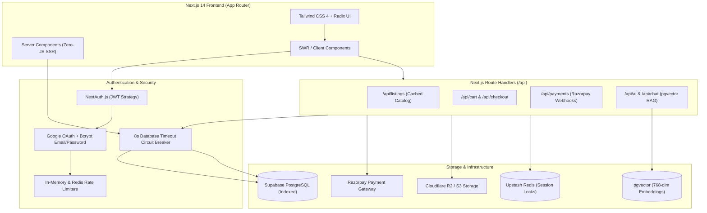

# 👗 WearShare

<div align="center">


### **Peer-to-Peer Community Wardrobe & Designer Outfit Rentals**

[](https://nextjs.org/)
[](https://react.dev/)
[](https://www.typescriptlang.org/)
[](https://tailwindcss.com/)
[](https://supabase.com/)
[](https://next-auth.js.org/)
[](https://razorpay.com/)

**Wear it once. Share it forward.**  
Premium ethnic and western wear for weddings, sangeets, college formals, and parties — rented directly from verified wardrobes within your neighbourhood pincode.

[🌐 Live Production Demo](https://wearshare.qzz.io) • [📖 Architecture & Flows](#-system-architecture) • [📚 Technical Deep-Dive](docs/TECH_ROADMAP_AND_ARCHITECTURE.md) • [📋 Project Summary](docs/PROJECT_SUMMARY.md) • [⚡ Quick Start](#-quick-start)

---

</div>

## 🌟 Highlights

<table>
<tr>
<td width="50%">

### 🛍️ For Renters
* **Hyperlocal Discovery:** Browse designer wear by category, city, pincode, size, gender, and occasion.
* **Smart Fit & Measurements:** Save body measurements (`height`, `chest`, `waist`, `hips`) for verified sizing.
* **Instant Booking & Cart:** Multi-day rental date range picker with live price, 5% damage protection, and refundable deposit calculations.
* **Seamless Checkout:** Integrated Razorpay checkout with instant booking confirmation.
* **Handover & Return Tracking:** Step-by-step trip tracking (`requested` → `approved` → `picked_up` → `returned`) with in-app chat.

</td>
<td width="50%">

### 💼 For Listers
* **Wardrobe Monetization:** Earn ₹500–₹5,000 monthly from outfits worn once and forgotten.
* **Complete Rental Control:** Set custom rental pricing, replacement deposit, and blackout calendars.
* **AI-Assisted Listing:** Automated titles, tags, and pricing suggestions powered by Gemini.
* **Request Management:** Review renter verification and approve or decline rental requests with 1-click.
* **Earnings & Analytics:** Real-time earnings tracker, pending payouts, and interactive revenue charts.
* **Protection & Claims:** Submit damage claims with photographic evidence directly through the platform.

</td>
</tr>
</table>

---

## 🏛️ System Architecture



---

## ⚡ Performance Benchmarks

Following deep architectural optimizations (connection pooling, conditional session resolution, and zero render-blocking web fonts):

| Route / Capability | Latency | Status | Optimization Details |
|:---|:---:|:---:|:---|
| **`GET /` (Landing Page)** | **582 ms** | `200 OK` | Selective column projection & ISR |
| **`GET /browse` (Catalog)** | **55 ms** | `200 OK` | Composite indexes on `(available, created_at)` |
| **`GET /api/listings?limit=4`** | **226 ms** | `200 OK` | Parametric limit & skipped auth overhead |
| **`GET /api/auth/session`** | **28 ms** | `200 OK` | In-memory token cache & decoupled session checks |
| **`GET /cart`** | **17 ms** | `200 OK` | Fast client-side hydration & conditional network calls |
| **`GET /listing/[id]`** | **168 ms** | `200 OK` | Single-query lookup & lightweight related items |
| **Font Loading** | **0 ms network** | Preloaded | Local bundle self-hosted via `next/font/google` |

---

## 🛠️ Tech Stack

| Area | Technologies |
|:---|:---|
| **Framework** | [Next.js 14](https://nextjs.org/) (App Router, Server Actions, Server Components) |
| **Language** | [TypeScript 5](https://www.typescriptlang.org/) (Strict Mode) |
| **Styling & UI** | [Tailwind CSS 4](https://tailwindcss.com/), [Radix UI](https://www.radix-ui.com/), [Lucide Icons](https://lucide.dev/) |
| **Typography** | `Fraunces` (Editorial Display) & `Inter` (Sans-Serif) via `next/font` |
| **Database** | [Supabase](https://supabase.com/) (PostgreSQL 15, Row Level Security, `pgvector`) |
| **Authentication** | [NextAuth.js v4](https://next-auth.js.org/) (Google OAuth, Bcrypt Email/Password, Email OTP) |
| **Payments** | [Razorpay](https://razorpay.com/) (Standard Checkout, Webhooks, Signature Verification) |
| **AI & Search** | Google Gemini (`gemini-2.5-flash`), Groq (`llama-3.3-70b-versatile`), pgvector cosine similarity |
| **Storage** | Cloudflare R2 / AWS S3 Presigned Uploads |
| **Rate Limiting** | Dual-tier sliding window (In-memory + [Upstash Redis](https://upstash.com/)) |

---

## 🚀 Quick Start

### 1. Prerequisites
* **Node.js** v20.0.0 or higher
* **npm** or **pnpm**
* A [Supabase](https://supabase.com/) project with Database access
* (Optional) [Razorpay](https://dashboard.razorpay.com/) test keys & [Google Cloud Console](https://console.cloud.google.com/) OAuth credentials

### 2. Clone & Install
```bash
git clone https://github.com/your-username/wearshare-app.git
cd wearshare-app
npm install
```

### 3. Configure Environment Variables
Create your local environment file:

```bash
cp .env.example .env.local
```

Fill in the essential configuration:
```ini
# Supabase Database
NEXT_PUBLIC_SUPABASE_URL="https://your-project.supabase.co"
NEXT_PUBLIC_SUPABASE_PUBLISHABLE_KEY="eyJhbGciOi..."
SUPABASE_SERVICE_ROLE_KEY="eyJhbGciOi..."

# Authentication
NEXTAUTH_URL="http://localhost:3000"
NEXTAUTH_SECRET="your-32-character-random-secret"

# (Optional) Social Sign-In
GOOGLE_ID="your-google-client-id"
GOOGLE_SECRET="your-google-client-secret"

# (Optional) Payments
RAZORPAY_KEY_ID="rzp_test_..."
RAZORPAY_KEY_SECRET="your-secret"
NEXT_PUBLIC_RAZORPAY_KEY_ID="rzp_test_..."

# (Optional) AI Assistance
GEMINI_API_KEY="your-gemini-key"
```

### 4. Setup Database Schema
Execute [`supabase/schema.sql`](supabase/schema.sql) in your **Supabase SQL Editor**.  
This initializes:
* Core tables: `users`, `listings`, `bookings`, `cart_items`, `wishlists`, `claims`, `trip_messages`
* Security & tokens: `security_events`, `email_otps`, `reset_tokens`
* Semantic AI: `pgvector` extension and the `match_listings` stored procedure
* Performance indexes for high-speed indexing across searches and bookings

### 5. Start the Application

```bash
# Development Mode with Hot Reload
npm run dev

# Optimized Production Build & Start
npm run build
npm run start
```

Visit **[http://localhost:3000](http://localhost:3000)** in your browser.

---

## 🗺️ Application Routes

```
wearshare-app/
├── app/
│   ├── (Storefront)/
│   │   ├── page.tsx                  # Landing page with featured collections & search
│   │   ├── browse/page.tsx           # Multi-filter search (category, price, pincode, size)
│   │   ├── listing/[id]/page.tsx     # Outfit detail, date-range picker & related items
│   │   └── how-it-works/page.tsx     # Platform trust, logistics & safety guide
│   ├── (Cart & Checkout)/
│   │   ├── cart/page.tsx             # Multi-item rental cart & fee breakdown
│   │   └── checkout/page.tsx         # Razorpay checkout & payment processing
│   ├── (Dashboard & Profile)/
│   │   ├── dashboard/renter/page.tsx # Renter active orders, history & measurements
│   │   ├── dashboard/lister/page.tsx # Lister wardrobe, incoming requests & earnings
│   │   ├── profile/page.tsx          # Account settings, address & sizing profile
│   │   └── trips/[id]/page.tsx       # Handover/return workflow & chat
│   ├── (Authentication)/
│   │   ├── login/page.tsx            # Google, email/password & email OTP login
│   │   └── reset/page.tsx            # Expiring password reset flow
│   └── api/                          # High-performance serverless endpoints
```

---

## 🔒 Security Architecture

* **Argon/Bcrypt Standards:** Industry-standard 10-round bcrypt hashing for all passwords.
* **Atomic Single-Use Tokens:** Password reset links and OTPs are stored exclusively as hashes with 5–15 minute expiration policies.
* **Server-Side Signature Verification:** All payment webhooks and checkout confirmations use HMAC-SHA256 signature verification before database order fulfillment.
* **Smart Circuit Breakers:** Global database timeout protection (8s) guarantees edge APIs fail gracefully without thread starvation.
* **Audited Security Events:** High-severity events (e.g. rate-limit breaches, credential errors) are tracked in `security_events` with hashed IP and User-Agent fingerprints.

---

## 🔮 Future Roadmap & Enhancements

Key strategic and technical avenues to take WearShare from MVP to production-scale:

```
[Phase 1: Real-Time Logistics]
  ├── Supabase Realtime WebSocket Chat for item pickup & return
  └── Courier API Integration (Dunzo / Porter / Shadowfax) for automated dispatch

[Phase 2: Trust & Identity]
  ├── Automated KYC verification (Aadhaar / DigiLocker via Cashfree / Signzy)
  └── Lister security deposit waivers for high-reputation renters

[Phase 3: AI-Powered Styling]
  ├── Virtual Try-On 2.0 (High-fidelity neural rendering on renter photos)
  └── Gemini Ensemble Recommender (Occasion-based matching with accessories)

[Phase 4: Global Caching & Scale]
  ├── PgBouncer / Supavisor connection pooling for serverless cold-start elimination
  └── Next.js 14 `unstable_cache` with on-demand tag revalidation across edge CDN
```

---

## 👤 Author

**Kuchipudi Yokshith Sai Ram Chowdary**  
GitHub: [@yokshith09](https://github.com/yokshith09)  
Email: yokshithkuchipudi09@gmail.com
